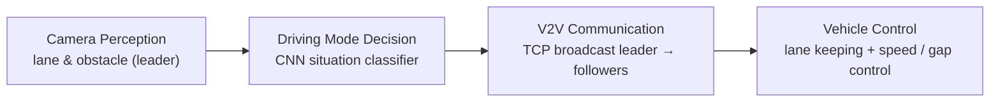

# Deep Learning-based Situation-Aware Platooning Assist System

> UROP (Undergraduate Research Opportunities Program) · 2025.09 – 2025.12 · 3-person team
> Raspberry Pi + Adeept PiCar-B

A platooning system for scaled vehicles. The leader vehicle classifies the driving situation from its camera with a lightweight CNN and broadcasts driving commands over V2V; follower vehicles keep their lane and gap while following the leader's mode.

<p align="center">
  
  <br><sub>1 leader + 2 followers on the test track with a static obstacle</sub>
</p>

---

## System Architecture



| Layer | Implementation |
|---|---|
| Perception | Pi Camera, OpenCV, ultrasonic sensor (HC-SR04) |
| Decision | CNN driving-situation classifier (PyTorch) |
| Communication | TCP socket broadcast from leader to followers |
| Control | PID steering from lane center offset, PCA9685 PWM for motor / servo |
| Monitoring | Flask web server: live video, driving mode, battery, remote control |

---

## Algorithms

### Driving Situation Classification (CNN)
- Architecture: (Conv → ReLU → Pooling) × 2 → MLP
- Output: 4 driving situations mapped to driving modes
- Driving modes: Normal / Platoon / Overtake / Leader Change
- F1 score 92.1%

### Lane Detection & Tracking
1. ROI crop (bottom of the frame)
2. Grayscale → Canny edge detection
3. Probabilistic Hough transform (`cv2.HoughLinesP`)
4. Line fitting (`np.polyfit`) → lane center estimation
5. PID control of steering angle from lane center offset

### V2V Platooning
- Leader runs a TCP server and broadcasts the current driving command to all followers.
- On Leader Change, the roles of leader and follower are switched.
- Followers keep the gap to the preceding vehicle using ultrasonic range (Kalman-filtered).

### Real-time Optimization: ROI Slicing
- Lane detection and CNN inference originally processed the full frame each (CPU 100%, 7.9 FPS).
- Task-specific ROIs are sliced at the front of the pipeline: lane = bottom 45%, perception = front 80% of the frame.
- Result: processing time −54%, **7.9 → 17.1 FPS** on Raspberry Pi.

---

## Demo

| Overtake mode | Real-time monitoring |
|---|---|
|  |  |
| Obstacle detected → Overtake mode | Driving mode · battery monitoring |

<p align="center">
  
  <br><sub>Lane tracking: ideal path (black) vs measured path (blue)</sub>
</p>

---

## Hardware

- Controller: Raspberry Pi (4B or later)
- Chassis: Adeept PiCar-B
- Sensors: Raspberry Pi Camera Module, ultrasonic sensor (HC-SR04), line tracking module
- Actuators: PCA9685 PWM driver, DC motors, MG90S servos (steering, camera pan/tilt)

---

## Repository Structure

| Path | Description |
|---|---|
| `src/Platooning_System/` | Main code: driving loop, lane detection (`processor.py`), motor control |
| `libs/adeept_picar-b2/` | PiCar-B hardware driver and setup script |
| `docs/` | Poster, report, slides, demo images |
| `media/` | Demo videos |

---

## How to Run

```bash
# 1. Install packages
pip3 install adafruit-circuitpython-pca9685 adafruit-circuitpython-motor adafruit-circuitpython-servokit flask opencv-python numpy torch torchvision

# 2. Set up the hardware driver
cd libs/adeept_picar-b2
sudo python3 setup.py

# 3. Run
cd ../../src/Platooning_System
python3 Platooning_System.py
```
