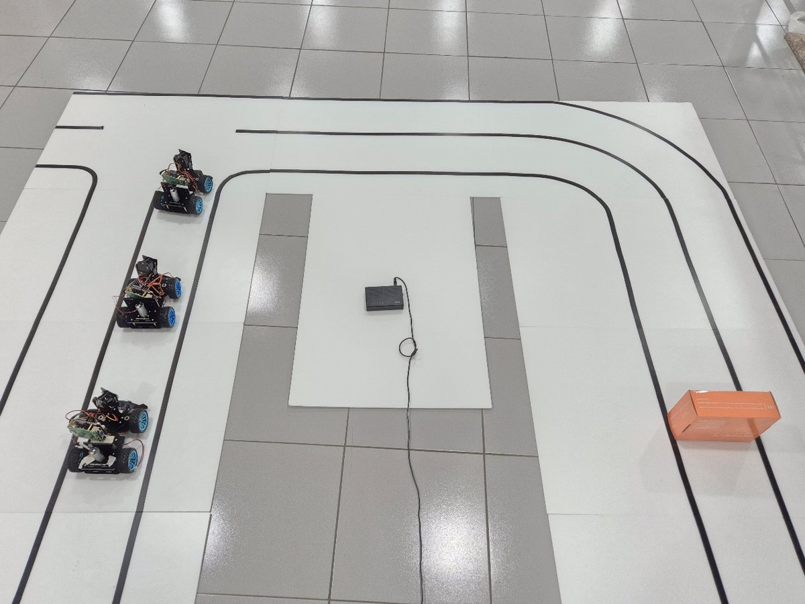
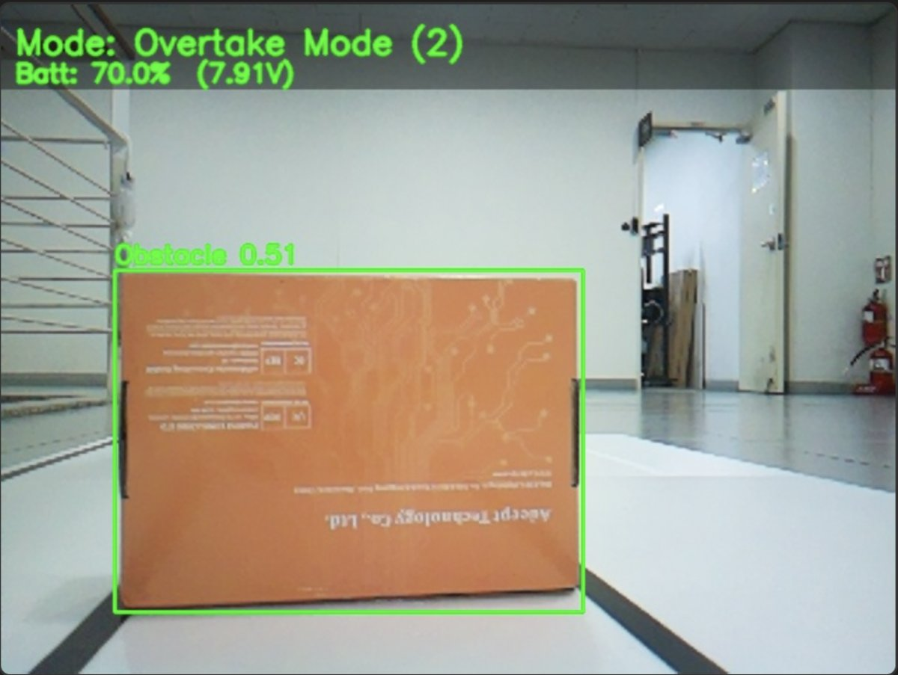
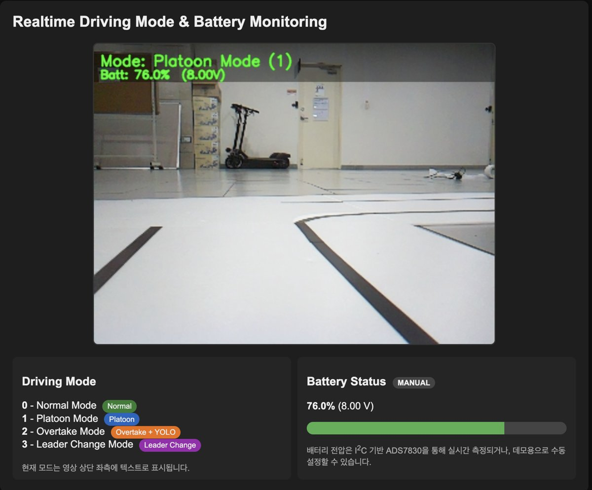
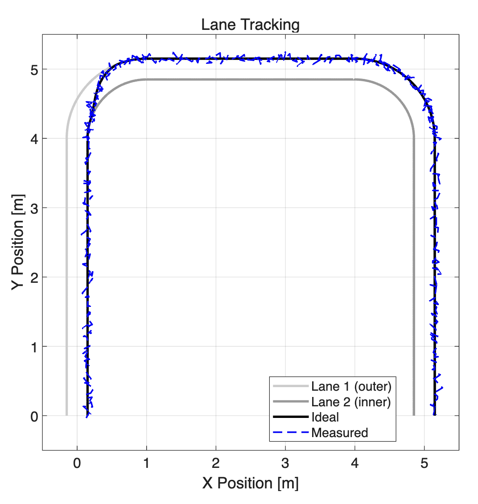

# 딥러닝 기반 상황인지 Platooning 보조 시스템

> 3학년 UROP(학부생 연구참여) · 3인 팀 · Raspberry Pi + Adeept PiCar-B
>
> 담당: 시스템 아키텍처 구성, CNN 모델 이식, 차선 검출 파이프라인 구현

---

## 프로젝트 개요

여러 대의 모형 차량이 V2V 통신으로 간격을 유지하며 군집 주행(Platooning)하고, 카메라 영상으로 주행 상황(차선, 장애물, 차량)을 인지해 주행 모드를 전환하는 시스템입니다.

<p align="center">
  
  <br><sub>리더 1대 + 팔로워 2대 군집 주행, 전방 장애물 배치 트랙</sub>
</p>

### 주요 기능

- **차선 추종**: OpenCV(Canny + ROI + Hough) 기반 차선 검출과 조향 제어
- **군집 주행**: 선행 차량과의 간격 유지
- **상황 인지**: 경량 CNN((Conv → ReLU → Pooling) ×2 + MLP)으로 카메라 영상의 주행 상황 4종 분류
- **주행 모드 전환**: Normal / Platoon / Overtake / Leader Change
- **원격 모니터링**: Flask 웹 인터페이스로 실시간 영상·센서 데이터 확인 및 원격 제어

---

## 시스템 구조


---

## 시연 자료

| 추월 모드 전환 | 실시간 모니터링 |
|---|---|
|  |  |
| 장애물 인식 후 추월 모드 전환 화면 | 주행 모드 · 배터리 실시간 모니터링 |

<p align="center">
  
  <br><sub>차선 추종 결과: 이상 경로(검정)와 실측 경로(파랑)</sub>
</p>

---

## 문제 해결: 임베디드 리소스 최적화

- **문제**: 라즈베리파이에 CNN 모델을 실장하자 CPU 점유율이 100%에 달해 처리 속도가 **7.9 FPS**로 떨어졌습니다.
  해상도 축소와 프레임 스킵만으로는 처리 시간이 줄지 않았습니다.
- **원인**: 차선 검출과 CNN 추론이 각각 프레임 전체를 연산하고 있었습니다.
- **해결**: 프레임을 확인해 차선은 **하단 45%**, 인지 대상은 **전방 80%** 영역에 나타난다는 점을 파악했습니다.
  이를 근거로 역할별 **ROI 슬라이싱**을 파이프라인 맨 앞에 배치해, 축소된 영역에서만 연산하도록 바꿨습니다.
- **결과**: 처리 시간 **54% 단축**, **7.9 → 17.1 FPS**

## 하드웨어 구성

- Controller: Raspberry Pi (4B 이상)
- Chassis: Adeept PiCar-B
- Sensors: Raspberry Pi Camera Module, 초음파 센서(HC-SR04), 라인 트래킹 모듈
- Actuators: PCA9685 PWM 드라이버, DC 모터, MG90S 서보(조향, 카메라 팬/틸트)

---

## 저장소 구조

| 경로 | 내용 |
|---|---|
| `src/Platooning_System/` | 메인 코드 (주행 루프, 차선 검출 `processor.py`, 모터 제어 등) |
| `libs/adeept_picar-b2/` | PiCar-B 하드웨어 드라이버 및 설치 스크립트 |
| `docs/` | 포스터, 결과 보고서, 발표 자료, 시연 사진 |
| `media/` | 시연 영상 |

---

## 실행 방법

```bash
# 1. 패키지 설치
pip3 install adafruit-circuitpython-pca9685 adafruit-circuitpython-motor adafruit-circuitpython-servokit flask opencv-python numpy torch torchvision

# 2. 하드웨어 드라이버 설정
cd libs/adeept_picar-b2
sudo python3 setup.py

# 3. 실행
cd ../../src/Platooning_System
python3 Platooning_System.py
```
